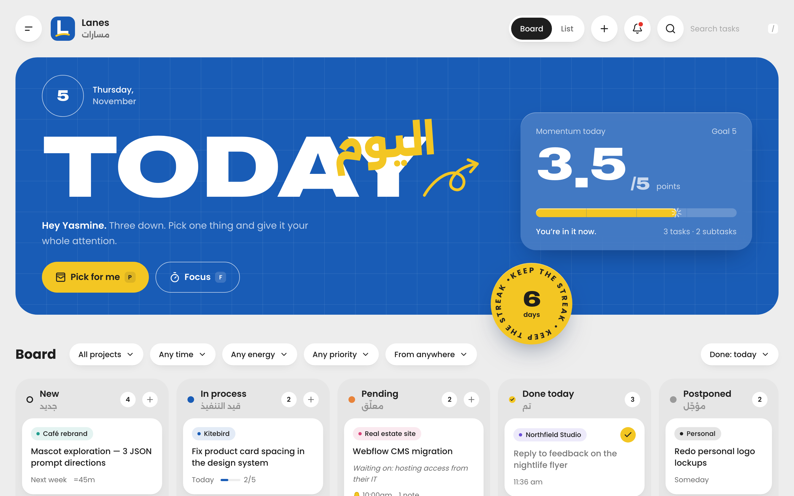
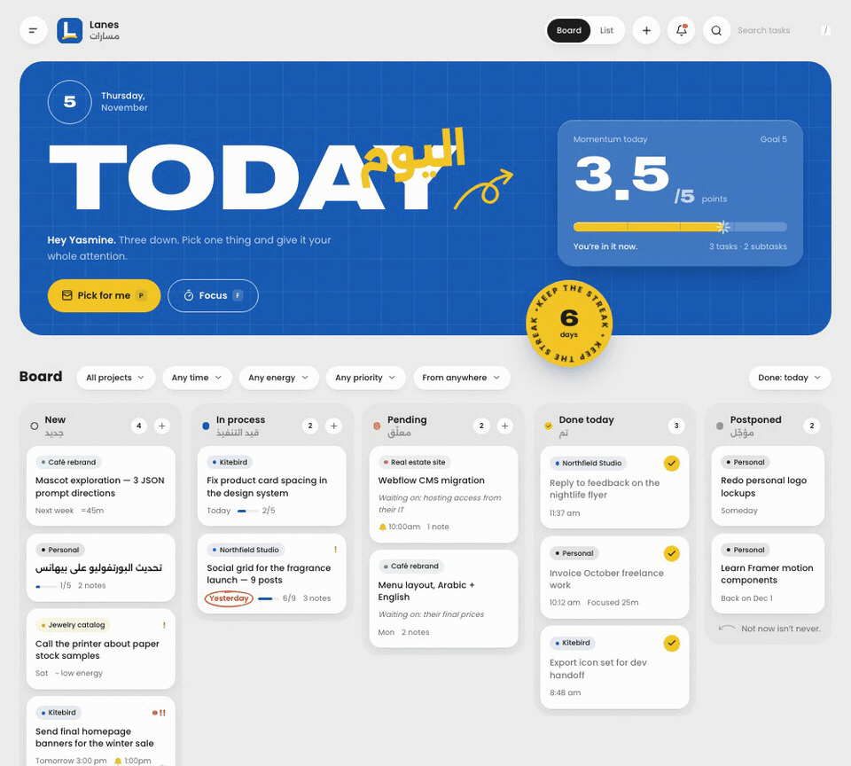
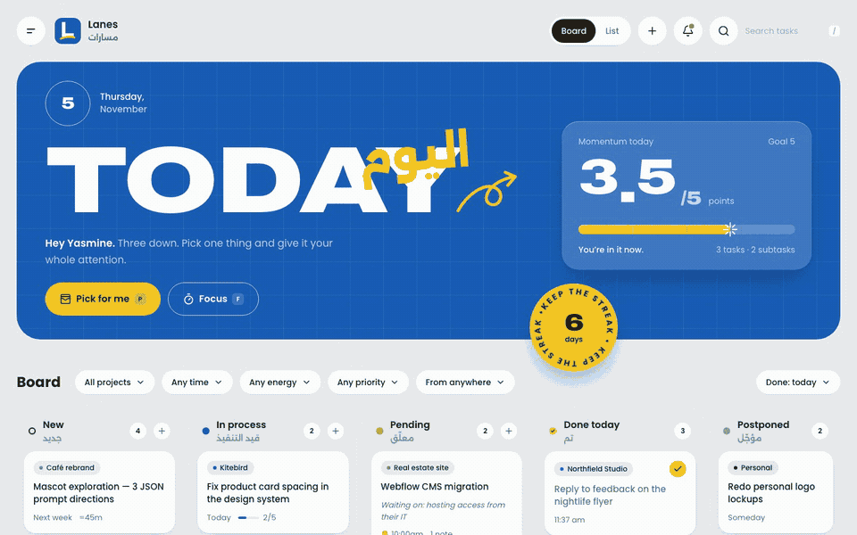
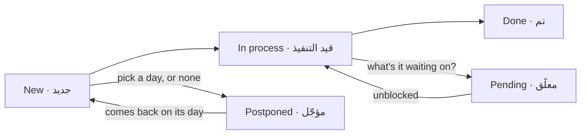
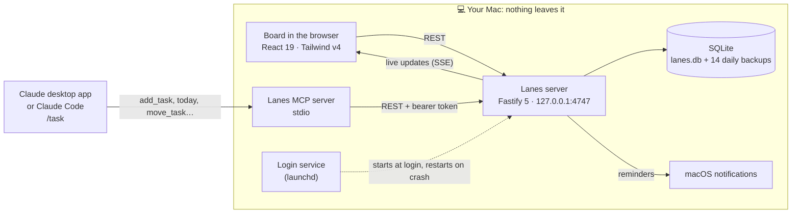
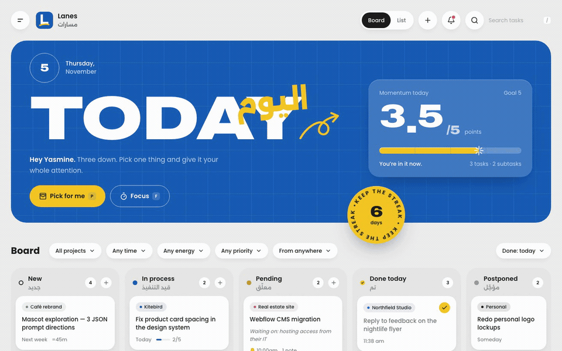
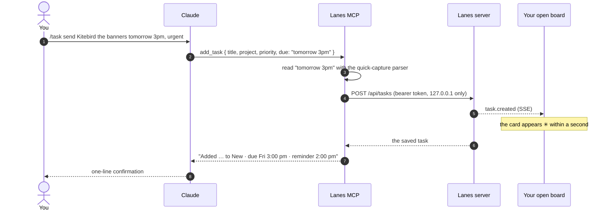

<div align="center">


# Lanes · مسارات

**A calm, local-first task board for one busy brain.**<br />
Five lanes, a momentum bar that only goes up, and Claude can add tasks with `/task`.

[](https://github.com/yasminehagagg1-spec/lanes/actions/workflows/ci.yml)


[](LICENSE)


[Features](#-features) · [The five lanes](#-the-five-lanes) · [How it works](#-how-it-works) · [Quick start](#-quick-start) · [Claude](#-claude-adds-tasks-with-task) · [Your data](#-your-data) · [Development](#-development)

<br />



</div>

<br />

## Why Lanes

Most task apps want an account, look like spreadsheets, and give nothing back for finishing things. Lanes is built the other way round:

| | |
|---|---|
| 🏠 **Yours, on your Mac** | One SQLite file. No account, no cloud, no telemetry. The server only listens on `127.0.0.1`. |
| 🌱 **Rewards progress, never punishes the backlog** | Momentum counts what you *finished* today against a daily goal. Adding tasks never makes the bar drop. |
| 🧠 **Low-friction by design** | Type naturally, one line per task. Dates, projects and priorities are picked up as you type. |
| ✳️ **Claude can help** | Type `/task …` in Claude and the card lands on your open board seconds later. |
| 🌍 **Bilingual** | English UI, Arabic labels, and Arabic text renders right-to-left everywhere, dates included (`بكرة الساعة ٥`). |

<br />

## ✨ Features

### Capture at the speed of thought

Press <kbd>N</kbd> or <kbd>⌘K</kbd> and type. Chips appear as Lanes understands you; click one to drop it. Paste a list and every line becomes a task.


<details>
<summary><b>Quick-capture cheat sheet</b></summary>

<br />

| Write | Means |
|---|---|
| `#Kitebird` | project (matched loosely to ones you already have) |
| `!high` `!urgent` `!low` | priority |
| `~low` `~med` `~high` | energy it needs |
| `tomorrow 3pm` · `by Thursday` · `بكرة الساعة ٥` | due date; a time also adds a reminder an hour before |
| `^1pm` · `^30m before` | reminder |
| `=30m` | estimate |
| `> their final prices` | lands in **Pending**, waiting on that |
| `?invoice` | search instead of adding |

<kbd>Enter</kbd> adds and keeps the box open · <kbd>⌘Enter</kbd> adds and opens the task · <kbd>⇧Enter</kbd> new line

</details>

### Finish things, and feel it

Drag a card to **Done** (or press <kbd>4</kbd>). The card gets stamped, confetti fires, the momentum number rolls up, and a hand-drawn underline appears under *TODAY* as you level up.



<details>
<summary><b>How momentum is counted</b></summary>

<br />

| Finished today | Points |
|---|---|
| A task | 1 |
| A step inside a task | 0.25 |
| A completed focus session | 0.5 |

Points are divided by your **daily goal** (default 5), with levels at 25 / 50 / 75 / 100%. Past 100% the bar keeps filling in "overdrive". "Today" starts at 6am by default, so finishing something at 1am still counts for the day you were living in.

The **streak** counts days with at least one finish and forgives one missed day per week. Two finishes within 10 minutes make a **combo**.

</details>

### Pending always says what it's waiting on

Moving a card to **Pending** asks one question. The answer stays on the card until it moves on, so nothing goes quiet without a reason.


### Focus mode

Press <kbd>F</kbd> on any card. A full-screen timer drains as you work, steps sit beside it, and the browser tab counts down. When time's up, it asks *"Where did you land?"*, and every session is logged in the task's notes.



<sub>Sped up: a one-minute session shown in a few seconds.</sub>

### Pick for me

Can't choose? Press <kbd>P</kbd>, say how much energy you have, and Lanes deals you one card with a reason, weighing due dates, priority, energy and what you've already started. Skip up to three times, then pick from the top three.


### More

- 🔔 **Reminders** arrive as macOS notifications even with the tab closed; click one to open the task. Postponed tasks come back to New on their day.
- 🗒️ **Notes in every stage**, shown as a timeline with stage changes, focus sessions and notes from Claude.
- 🔎 **Filters and search** by project, due date, energy, priority and source, plus a list view.
- ⌨️ **Keyboard-first**: arrow keys between cards, <kbd>1</kbd>–<kbd>5</kbd> to move, <kbd>/</kbd> to search.
- 📲 **Installable** as its own app in the Dock (Chrome or Safari).
- ♿ **Respects reduced motion**: celebrations can be full, subtle or off.

<br />

## 🧭 The five lanes

| Lane | | What it means |
|---|---|---|
| **New** | جديد | Everything you dumped in. Sort it later. |
| **In process** | قيد التنفيذ | Started. Focus mode moves a card here for you. |
| **Pending** | معلّق | Waiting on someone or something, and it always says what. |
| **Done today** | تم | Finished today. Older wins are one click away. |
| **Postponed** | مؤجّل | *Not now isn't never.* Pick a day and it comes back to New on its own. |



Cards can move between any two lanes; these are the usual paths. Every move goes through one server-side `moveTask()`, so the board, keyboard shortcuts and Claude all follow the same rules.

<br />

## 🏗 How it works



- **Live everywhere.** Every change is pushed to open tabs over Server-Sent Events, so a task Claude adds shows up without a refresh.
- **Optimistic UI.** Cards move instantly; if the server says no, they move back with a toast.
- **Safe by default.** Requests addressed to anything but localhost are refused, which blocks DNS-rebinding attacks. Only the board's own page is trusted without a key; everything else needs the bearer token in `<data>/token` (file mode 600).
- **Calm when offline.** If the server is asleep, a banner says so and nothing fails silently.

<br />

## 🚀 Quick start

**You need:** macOS, Node 22+ and pnpm.

```bash
git clone https://github.com/yasminehagagg1-spec/lanes.git
cd lanes
pnpm install
scripts/install-launchagent.sh   # builds Lanes, starts it now and at every login, adds the `lanes` command
lanes open                       # → http://localhost:4747
```

That's it. To make it an app in the Dock: in Chrome, ⋮ → *Cast, save and share* → *Install page as app*. In Safari: *File → Add to Dock*.

<details>
<summary><b>The <code>lanes</code> command</b></summary>

<br />

| Command | What it does |
|---|---|
| `lanes open` | Opens the board (wakes Lanes first if needed) |
| `lanes status` | Awake or asleep, how many tasks, where the data is |
| `lanes start` / `lanes stop` | Wake it / put it to sleep (it wakes again at the next login) |
| `lanes restart` | Stop and start (after changing the code, run `pnpm build` first) |
| `lanes backup` | Save a backup right now |
| `lanes logs` | The end of the server log |
| `lanes token` | The key other tools use to talk to Lanes |

To remove the login service: `scripts/install-launchagent.sh --uninstall`. Your data stays.

</details>

<details>
<summary><b>Keyboard shortcuts</b></summary>

<br />

| Key | |
|---|---|
| <kbd>N</kbd> or <kbd>⌘K</kbd> | Quick capture |
| <kbd>/</kbd> | Search |
| <kbd>P</kbd> | Pick for me |
| <kbd>F</kbd> | Focus on the selected task |
| <kbd>1</kbd>–<kbd>5</kbd> | Move the selected card to New / In process / Pending / Done / Postponed |
| <kbd>←</kbd> <kbd>↑</kbd> <kbd>→</kbd> <kbd>↓</kbd> | Move between cards |
| <kbd>Enter</kbd> / <kbd>Esc</kbd> | Open / close |

</details>

<details>
<summary><b>Brand fonts and notifications</b></summary>

<br />

- **Fonts:** licensed brand fonts aren't in the repo. Drop them into `packages/web/public/fonts/` (the README there lists the names) and run `pnpm build`. Until then, close Google Fonts stand in.
- **Notifications:** if reminders don't appear, open System Settings → Notifications and allow **terminal-notifier** (and **Script Editor**, the fallback).

</details>

<br />

## ✳️ Claude adds tasks with `/task`



<sub>Recorded with the real connector: the card is added through the same MCP <code>add_task</code> tool Claude calls.</sub>

```bash
scripts/connect-claude.sh --dry-run   # see what it would change
scripts/connect-claude.sh             # connect the Claude desktop app + Claude Code, install /task
```

The script adds only the `lanes` entry to Claude's config and backs the file up first. For the **desktop app**, restart it and upload `dist/lanes-task-skill.zip` in *Settings → Capabilities → Skills*.



Claude can also answer *"what's on my plate today?"*, move tasks (with the same Pending rules), and add notes and reminders. It can't delete anything; that stays a human action in the app. Settings → **Claude** shows whether each part is connected.

<br />

## 🗂 Your data

- Everything lives in `~/Library/Application Support/Lanes/lanes.db`. Clearing browser history loses nothing.
- **Daily backups** go to `…/Lanes/backups/` (the last 14 are kept), plus one before every import.
- **Settings → Your data**: Export · Import (*add to this board* or *replace everything*) · Back up now · Open folder.

<details>
<summary><b>Restore a backup by hand</b></summary>

<br />

```bash
lanes stop
cd ~/Library/Application\ Support/Lanes
cp lanes.db lanes-before-restore.db       # just in case
cp backups/lanes-2026-11-05.db lanes.db   # the backup you want
rm -f lanes.db-wal lanes.db-shm
lanes start
```

**Moving to another Mac:** Export on the old one, set up Lanes on the new one, then Import → *Replace everything*.

</details>

<details>
<summary><b>When something's off</b></summary>

<br />

| You see | Try |
|---|---|
| "Lanes is sleeping" banner | `lanes start` (or `lanes logs` if it won't wake) |
| Claude says Lanes isn't running | `lanes status`, then `lanes start` |
| `/task` isn't offered in Claude Code | run `scripts/connect-claude.sh` again, then start a new session |
| No reminder notifications | allow terminal-notifier in System Settings → Notifications |
| Port 4747 is busy | another Lanes was started by hand (e.g. `pnpm start`): stop it, then `lanes start` |

</details>

<br />

## 🛠 Development

```bash
pnpm dev        # server + web with hot reload, on a dev data folder (.data-dev)
pnpm seed       # fill the dev board with sample tasks
pnpm test       # 154 unit tests: shared logic, server, Claude connector
pnpm e2e        # 35 browser tests on a throwaway data folder (.data-e2e)
pnpm lint && pnpm typecheck
```

Dev and test runs always use their own data folder, never your real board. After changing code, `pnpm build && lanes restart` updates the Lanes you use every day.

```
lanes/
├─ packages/
│  ├─ shared/   zod schemas, stage rules, the natural-language parser, momentum & pick-for-me logic
│  ├─ server/   Fastify API, SQLite, scheduler, notifications, backups, export/import
│  ├─ web/      React 19 board, quick capture, focus, pick-for-me, settings
│  └─ mcp/      the Claude connector (stdio MCP server)
├─ claude/skills/task/   the /task skill
├─ scripts/     lanes CLI · install-launchagent · connect-claude · icons · README demos
├─ e2e/         Playwright browser tests
├─ docs/        product spec, architecture, data model, API, Claude integration, build plan
└─ design/      design system, tokens, mockup
```

<details>
<summary><b>Re-record the demos in this README</b></summary>

<br />

```bash
pnpm build
node scripts/readme-media/record.mjs            # all of them
node scripts/readme-media/record.mjs focus pick # just some
```

Each demo is recorded in a real browser at 1440×900 against a fresh copy of the sample board, then turned into a GIF in `lanes_gifs/` with ffmpeg. Your real data is never touched.

</details>

<br />

## License

[MIT](LICENSE): use it, change it, share it; just keep the copyright notice.

Brand fonts aren't included and keep their own licenses.

<br />

<div align="center">
<sub>Built with <a href="https://claude.com/claude-code">Claude Code</a> · designed for one person, on one Mac, with a lot going on.</sub>
</div>
